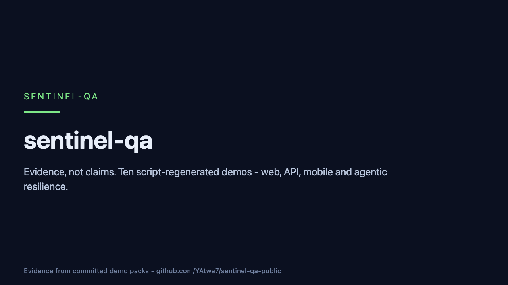

# sentinel-qa

**Evidence-first test engineering: web, API, mobile, and agentic quality — with the receipts.**

**[Watch the 57-second showcase →](demos/showcase/linkedin-showcase.mp4)**

The video is a cut of the project's own committed test artifacts: real run
recordings, rendered transcripts, and report pages. No re-enactments, no
invented numbers, no voiceover. Every source is sha-verified before assembly
([source manifest](demos/showcase/source-manifest.json)); the caption used for
the LinkedIn post is [here](demos/showcase/POST.md).

## What this demonstrates

| Area | What shipped | Proof |
| :--- | :--- | :--- |
| Web | Playwright suite — 25 tests, zero retries; accessibility and visual regression gates; anti-bot abort contract and a loopback challenge sandbox | [demo 1](demos/demo-1-web/results.md) |
| API | OpenAPI breaking-change gate that refuses a real breaking diff; two-identity authorization matrix; fuzz, OWASP, and rate-limit lanes | [demo 2](demos/demo-2-api-contract/results.md) · [demo 3](demos/demo-3-api-security/results.md) |
| Mobile | Four Maestro flows on Android (AVD) and iOS (simulator), each recorded during the same run that produced its results | [demo 4](demos/demo-4-mobile-android/results.md) · [demo 5](demos/demo-5-mobile-ios/results.md) |
| Agentic quality | Eval gate with honest live-provider refusal; roster/orchestrator audit; self-healer that applies a real patch; dashboard over real results with absence visible | [demo 7](demos/demo-7-live-evals/results.md) · [demo 8](demos/demo-8-roster-audit/results.md) · [demo 9](demos/demo-9-self-healer/results.md) · [demo 10](demos/demo-10-dashboard/results.md) |
| Reporting | One unified report over four lanes (102 rows), regenerated by committed tooling | [demo 6](demos/demo-6-unified-report/results.md) |

The [evidence index](docs/EVIDENCE.md) lists every pack; the
[architecture note](docs/ARCHITECTURE.md) explains how the pieces fit together.

## How the work is held to a standard

- **Every claim has an artifact.** Demos are regenerated by committed scripts;
  media carries a two-way sha sweep, so a swapped or stale screenshot fails.
- **A check must be able to fail.** Each gate ships a negative control, and the
  guard's own controls are tested on synthetic scratch trees.
- **Independent review.** Changes land through branch → pull request →
  independent reviewer → merge → versioned release. A red run is committed
  red; retries to green are not a thing here.
- **Privacy by construction.** Credentials live outside the repository;
  fixtures, logs, and traces are treated as public surface. Machine-local
  paths and token shapes are scrubbed before anything is written.
- **Authorized targets only.** Public practice stores and loopback services.
  A bot challenge aborts the run as "blocked by bot protection" — it is never
  solved, masked, or retried away.

## Author

Built by Joey (YAtwa7).

## License

[PolyForm Noncommercial 1.0.0](https://polyformproject.org/licenses/noncommercial/1.0.0) —
free to study, fork, and use for non-commercial (including portfolio) purposes;
written permission is required for commercial use. See [LICENSE](LICENSE).
